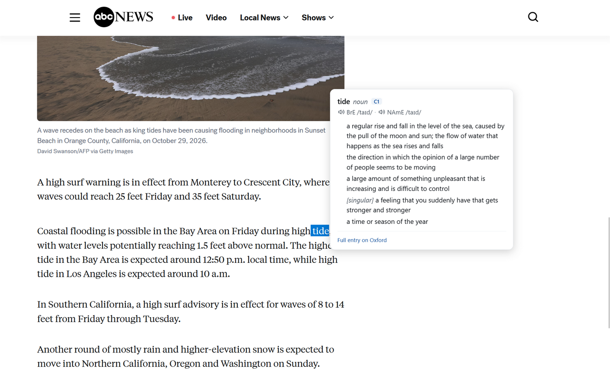
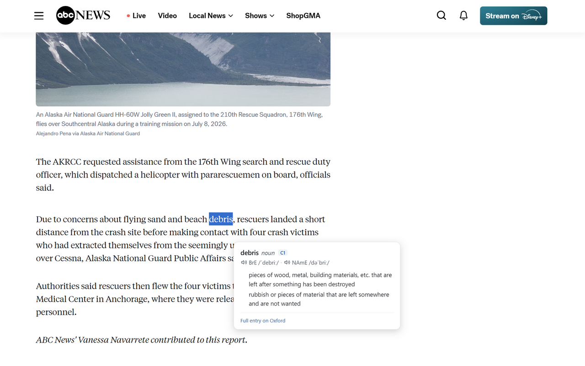
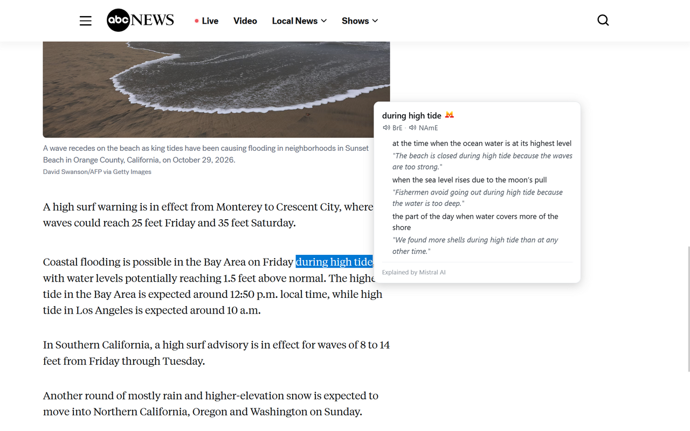
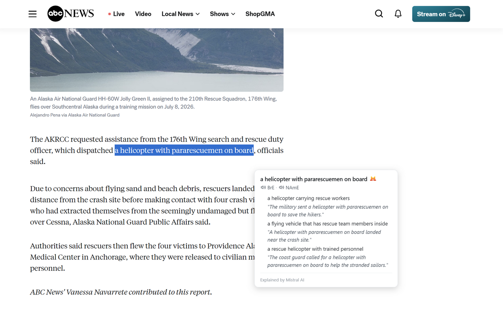

# R3_LISTING.md — listing readiness round (R3)

Owner state (2026-11-13): the store screenshots are already committed by the
owner at docs/screenshots/ (sage-firefox-word.png, sage-firefox-phrase.png,
sage-chrome-word.png, sage-chrome-phrase.png — 1280x800 each). This round
wires them into the README and closes two documentation gaps found in the
R2 audit. ZERO code changes.

## §1 Ground rules

- Docs-only round: do NOT touch src/, tests/, scripts/, manifest.json,
  options.html, content.css, build.mjs, or any PNG in docs/screenshots/.
  Only README.md and PRIVACY.md change.
- .github/workflows/tests.yml was already updated by the reviewer in main
  (push trigger now covers this round's branch) — do not modify it.
- One task = one commit, prefix `R3.<n>:`. Push ONLY
  `git push origin listing:listing`.
- All new/edited text is taken from this spec VERBATIM — the reviewer
  diffs it byte-for-byte. Do not paraphrase.

## §2 R3.1 — README: new "Screenshots" section

Insert this section immediately BEFORE the `## Settings` heading
(one blank line on each side; content exactly as fenced):

```markdown
## Screenshots

| Firefox | Chrome |
| --- | --- |
|  |  |
|  |  |
```

## §3 R3.2 — README: phrase-TTS bullet

In the "What the popup shows" bullet list, add this bullet directly after
the AI-phrases bullet (the one ending "uses your own API key — see
Settings)"):

```markdown
- phrase explanations can also be read aloud — BrE/NAmE speak buttons in
  the AI popup use the browser's built-in text-to-speech (word lookups keep
  the native Oxford audio)
```

## §4 R3.3 — PRIVACY.md: text-to-speech bullet

In the "What leaves your browser" list, add this bullet directly after
the "AI explanations" bullet (the one ending "the provider's own privacy
policy applies to it."):

```markdown
- **Phrase read-aloud.** Phrase explanations can be read aloud with the
  browser's built-in text-to-speech. The extension itself sends nothing:
  the phrase is passed to the browser, which uses the voices installed on
  your system (your browser's own privacy policy applies to any voice it
  provides).
```

## §5 Verification (reviewer)

- CI green on `listing` (docs-only, must not be able to break it).
- README differs from main only in the two zones (Screenshots section +
  TTS bullet); PRIVACY.md only in the added bullet; byte-for-byte against
  §2/§3/§4.
- The images referenced by the README exist in docs/screenshots/ with
  exactly those names.

## §6 Process rules (unchanged from previous rounds)

Fresh chat per round; the agent never pushes to main, never merges,
rebases or tags; push only by the explicit refspec; commit messages in
English with the R3.<n> prefix; escape sequences are written as escapes
(a raw newline inside a string literal is an autoblock); the report ends
with the literal output of `git log --oneline origin/main..HEAD`; claims
about work not present in that log are an autoblock; out-of-scope ideas
go in the report, not the code.
