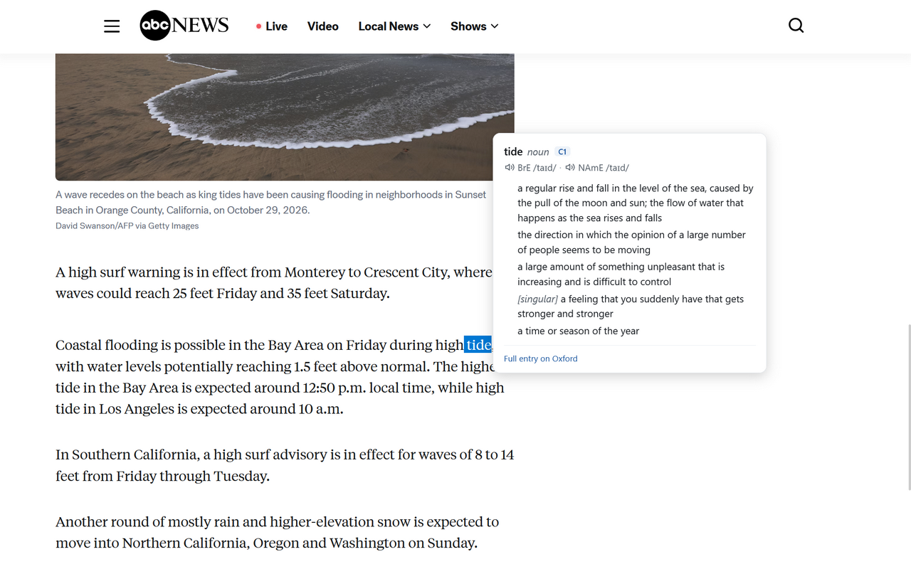
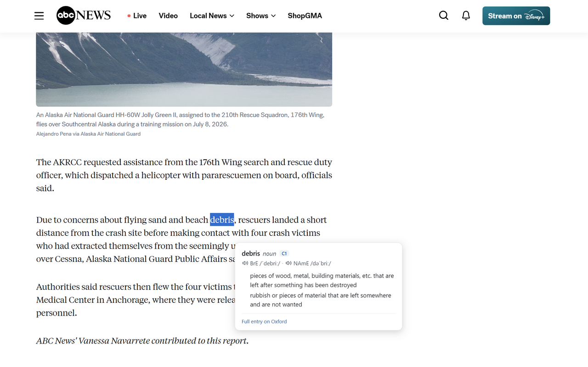
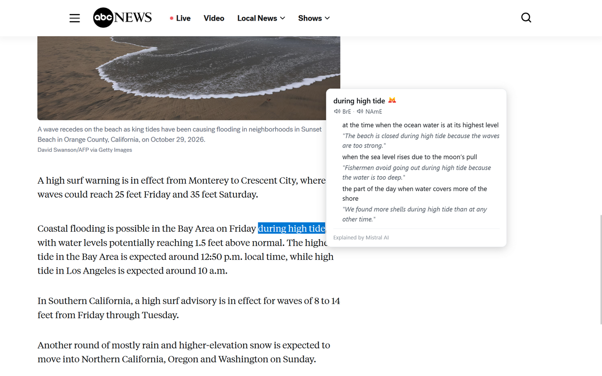
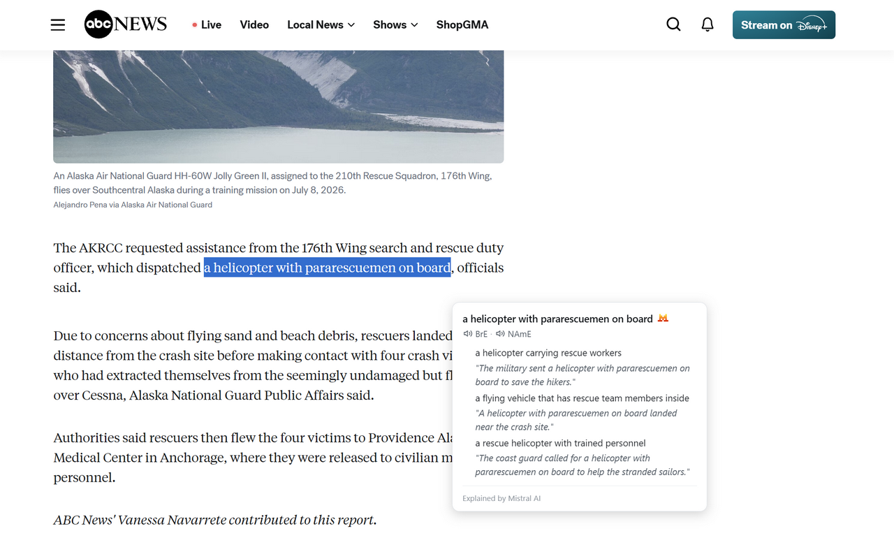

# Sage Pop-Up

A minimal browser extension: select a word, click the floating button that
appears next to it, and see the word's definition from the
[Oxford Learner's Dictionary](https://www.oxfordlearnersdictionaries.com) in a
small popup — the same flow as Simple Translate, but with an English
definition instead of a translation.

Works in both Chrome and Firefox (Manifest V3).

## What the popup shows

- headword, part of speech, UK/US transcription
- CEFR level badge (A1–C2) for Oxford 3000/5000 words
- one-click UK/US pronunciation (the audio files come from Oxford's own
  entry pages — no third-party TTS)
- all senses of the first dictionary entry (numbered, with grammar labels
  like *[uncountable]*)
- a link to the full entry on oxfordlearnersdictionaries.com
- the popup always fits on screen: it flips above the word or clamps to
  the viewport edge (with its own scrollbar for long entries)
- if the word is not found — a link to an Oxford search
- phrases (2+ selected words) and words missing from Oxford are explained
  by an AI provider of your choice, streamed into the same popup and
  marked with the provider badge — the Mistral logo for Mistral,
  the provider's name for the others (uses your own API key — see Settings)
- phrase explanations can also be read aloud — BrE/NAmE speak buttons in
  the AI popup use the browser's built-in text-to-speech (word lookups keep
  the native Oxford audio)

Inflected forms are handled automatically: the original selection is tried
first (many inflections like *went* or *knives* have their own Oxford
entries), then likely base forms — plurals (*-s, -es, -ies, -ves, -ses*),
verb forms (*-ed, -ing*), and a few irregulars (*children → child*). For
phrases only the last word is varied (*cocoa beans → cocoa bean*).

The popup stays open while you scroll the page or the popup itself; close it
with a click outside or `Esc`.

## Screenshots

| Firefox | Chrome |
| --- | --- |
|  |  |
|  |  |

## Settings

The AI fallback is BYOK ("bring your own key"): you pick a provider and
paste your own API key. The settings page has:

- a **provider dropdown** with the 8 supported providers — Mistral,
  OpenAI, Groq, OpenRouter, DeepSeek, xAI, Anthropic, Google Gemini;
- a per-provider **API key** field (paste, **Test key**, **Save**) and a
  per-provider **model** field. The model field is free text: the
  placeholder shows the built-in suggestion for that provider, which may
  be stale — type any model your provider offers. Get a key in your
  provider's console (e.g.
  [https://console.mistral.ai/api-keys](https://console.mistral.ai/api-keys)).
- keys are stored only in `chrome.storage.local` in your browser and are
  sent only to the selected provider's endpoint over HTTPS — no server,
  no analytics.

The default provider is Mistral, so keys saved by earlier versions keep
working unchanged: a previously saved Mistral key is migrated read-only and
working as-is, with zero behavior change.

Each provider origin is an **optional** host permission: the settings
page shows its state and has a **Grant access** button (the same prompt
appears automatically on **Test key**); switching the provider re-checks
the new origin. Firefox does not grant newly added host permissions on
extension reload — after re-loading a temporary add-on, click
**Grant access** once and the AI fallback works again. It can also be
enabled manually:
`about:addons → Sage Pop-Up → «Разрешения и данные»`.

Without a key for the selected provider everything Oxford keeps working;
AI fallback simply degrades to the usual "no definition found" UI.

## Development

The repo no longer loads as-is — it must be built first.

Prerequisites: Node.js >= 22 and the `zip` CLI (the build zips `dist/`
through the system `zip`; it is present on GitHub runners, Linux and macOS —
on Windows use WSL or Git Bash).

```sh
npm install
npm run build
```

Outputs: a loadable `dist/` folder and `dist/sage-popup.zip` (the zip
contains ONLY the `dist` contents at the zip root — the same layout as
every shipped version).

## Load the extension

### Firefox (temporary, until the browser closes)

1. Open `about:debugging#/runtime/this-firefox`
2. Click **Load Temporary Add-on…**
3. Pick `dist/manifest.json`

For a permanent install, the extension must be signed via
[addons.mozilla.org](https://addons.mozilla.org/) (or self-distribution with
`web-ext sign`).

### Chrome

1. Open `chrome://extensions`
2. Enable **Developer mode** (top right)
3. Click **Load unpacked**
4. Pick the `dist` folder

## How it works

```
selection → floating icon → click
  single word:
  → content.js asks background.js to fetch
      https://www.oxfordlearnersdictionaries.com/definition/english/<word>
  → background.js fetches the page (host_permissions bypass CORS),
    returns raw HTML
  → content.js parses it with DOMParser and renders the popup
  phrase (2+ words) or word missing from Oxford:
  → content.js opens a runtime port to background.js
  → background.js streams a chat completion from the selected provider
      (POST to that provider's streaming endpoint, the key from
      chrome.storage.local is sent only to that provider —
      OpenAI-compatible providers, Anthropic and Gemini each have their
      own streaming adapter)
  → content.js renders the streamed chunks as the same numbered list
```

- `src/background/` — `inflect.ts`, `lookup.ts`, `ai-prompt.ts`,
  `stream-openai.ts`, `stream-anthropic.ts`, `stream-gemini.ts`, `main.ts`:
  fetching definition pages + a small in-memory cache, multi-provider
  streaming over a runtime port
- `src/content/` — `dom.ts`, `normalize.ts`, `parser.ts`, `parse-ai-items.ts`,
  `audio.ts`, `tts.ts`, `popup.ts`, `main.ts`: selection handling, the
  floating icon, the popup, HTML parsing, streaming AI rendering
- `src/options/main.ts` — the provider / API-key / model settings page logic
- `src/shared/types.ts` — message protocol types
- `src/shared/providers.ts` — the provider registry + storage helpers
- `content.css` — popup styles
- `options.html` — the settings page markup
- `manifest.json` — the extension manifest
- `make_icons.py` — regenerates the icons (optional, Python stdlib only)

The build bundles the TypeScript sources into `dist/background.js`,
`dist/content.js` and `dist/options.js`.

## Project structure

```
sage-popup/
├─ src/
│  ├─ background/    # inflect, lookup, ai-prompt, stream-openai, stream-anthropic, stream-gemini, main
│  ├─ content/       # dom, normalize, parser, parse-ai-items, audio, tts, popup, main
│  ├─ options/       # main.ts (provider/key/model settings page logic)
│  └─ shared/        # types.ts (message protocol), providers.ts (provider registry + storage helpers)
├─ tests/            # vitest specs
│  └─ fixtures/      # committed Oxford HTML pages (parser regression suite)
├─ scripts/          # build.mjs, fetch-fixtures.mjs, live-check.js
├─ dist/             # build output (gitignored) — load this folder / zip
├─ content.css  options.html  manifest.json  make_icons.py  icons/
└─ package.json  tsconfig.json  vitest.config.ts  LICENSE  PRIVACY.md
```

## Test

`npm test` runs vitest fully offline: inflection + prompt, AI answer
parsing, and the Oxford parser fixtures (`tests/fixtures/`).
`scripts/live-check.js` stays the separate online canary.

## Permissions

- `host_permissions: https://www.oxfordlearnersdictionaries.com/*` — only
  this one. `optional_host_permissions` lists the 8 provider origins
  (`api.mistral.ai`, `api.openai.com`, `api.groq.com`, `openrouter.ai`,
  `api.deepseek.com`, `api.x.ai`, `api.anthropic.com`,
  `generativelanguage.googleapis.com`) — nothing else.
  The extension reads every page
  you select text on (any site) but sends data only to the Oxford dictionary
  domain and, for the AI fallback, to the selected provider with your own
  key. The key itself stays in `chrome.storage.local`. No analytics.

## Maintenance

If Oxford changes their markup, fix the selectors in `parseEntry()` in
`src/content/parser.ts` (the selector table below stays). The committed
fixtures in `tests/fixtures/` plus the parser tests guard it offline;
refresh the fixtures with `scripts/fetch-fixtures.mjs` and commit the
refreshed files.

| what | selector |
| --- | --- |
| entry | `div.entry` |
| headword | `h1.headword` |
| part of speech | `.webtop .pos` |
| UK/US transcription | `.phons_br .phon` / `.phons_n_am .phon` |
| senses list | `ol.senses_multiple, ol.sense_single` |
| sense | `li.sense` |
| grammar label | `.sensetop .grammar` |
| definition | `.def` |

## CI (GitHub Actions, free tier)

`.github/workflows/tests.yml` runs on every push to `main` and the active round branches,
daily at 09:30
Minsk time, and manually (Actions tab → "Run workflow"):

1. **Install** — `npm install` (no `package-lock.json` by design).
2. **Build** — type-check (`tsc --noEmit`) + esbuild bundles into `dist/`
   + zip of the `dist` contents into `dist/sage-popup.zip`.
3. **Unit tests** — `npm test` (vitest, fully offline: inflection + prompt,
   AI answer parsing, Oxford parser fixtures).
4. **Live checks** — `scripts/live-check.js` fetches real Oxford pages
   (`cocoa`, `house`, `walk`) and asserts every markup marker the parser
   depends on (headword, def, phons_br, pron-uk, data-src-mp3, senses lists,
   CEFR symbols), plus that all 8 provider endpoints resolve
   (network-level reachability — any HTTP answer counts, DNS death fails).
   If Oxford changes its markup or a provider domain breaks again, the run
   fails and
   GitHub emails the account owner (default "workflow failure on schedule"
   notifications — see Settings → Notifications → Actions).
5. **Artifact** — `dist/sage-popup.zip` is uploaded as a run artifact
   (`sage-popup`), so the built zip can be downloaded from the Actions
   run page.

One gotcha: GitHub disables **scheduled** workflows after 60 days of repo
inactivity; regular pushes keep it alive.

## License

MIT — see [LICENSE](LICENSE).

## Privacy

See [PRIVACY.md](PRIVACY.md): no accounts, no analytics, no servers — the
selected text goes only to the Oxford dictionary site and, for AI
explanations, to the provider you pick with your own key.
